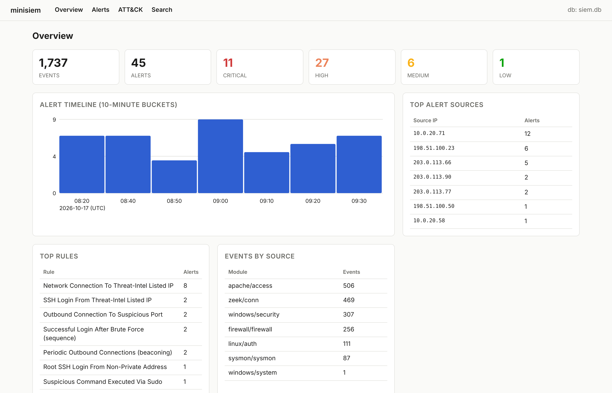
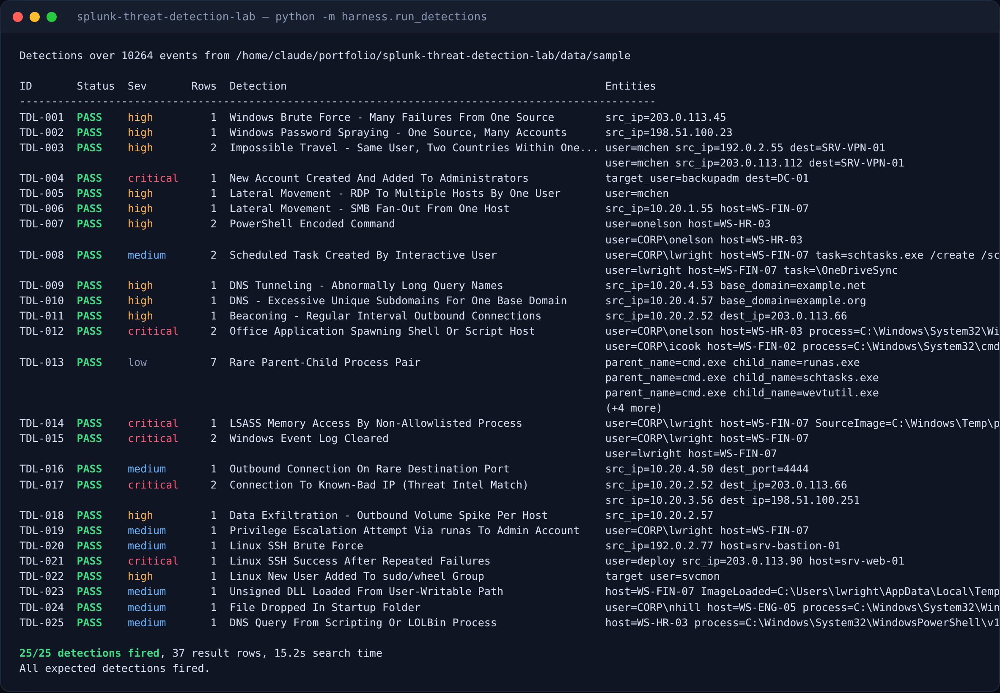
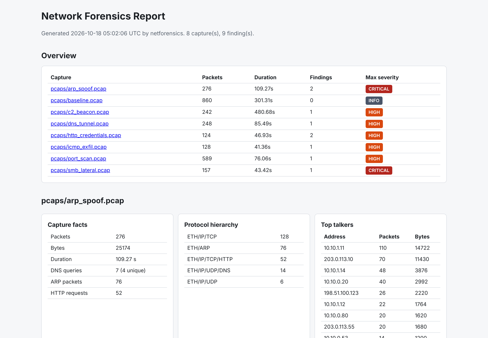

# JP Scirica

**SOC Analyst · Detection Engineering · Incident Response**
CompTIA Security+ | UT Austin McCombs Cybersecurity Postgraduate (4.13 GPA) | Houston, TX

I build the things SOC teams run on — SIEM detections, packet-level investigations, IAM access reviews and incident-response playbooks — and I publish them as **runnable, tested code with synthetic data**, not screenshots.

---

## What the projects actually produce

| SIEM From Scratch — live dashboard | Splunk lab — 25/25 detections firing |
|---|---|
|  |  |

---

## Portfolio

| Project | What it proves | Stack |
|---|---|---|
| [**siem-from-scratch**](https://github.com/brooklynkid707-cmd/siem-from-scratch) | How a SIEM works under the hood: syslog ingestion → ECS-style normalization → 25 Sigma rules + stateful correlation → alerting → SQLite → Flask dashboard with ATT&CK heatmap. Catches full attack chains. 37 tests. | Python, Sigma, SQLite, Flask |
| [**microsoft-sentinel-detection-engineering**](https://github.com/brooklynkid707-cmd/microsoft-sentinel-detection-engineering) | Detection-engineering-as-code: 28 Sentinel analytics rules + 12 hunting queries (KQL, ATT&CK-mapped), workbook, Logic App SOAR playbooks, Bicep deployment, rule validator/linter, Navigator coverage layer, GitHub Actions CI. 43 tests. | KQL, Bicep, ARM, GitHub Actions |
| [**splunk-threat-detection-lab**](https://github.com/brooklynkid707-cmd/splunk-threat-detection-lab) | Production-style Splunk app with 25 SPL detections (brute force, lateral movement, encoded PowerShell, DNS tunneling, beaconing, LSASS access…), field extractions, dashboard, synthetic log generator and a pure-Python SPL evaluator that proves 25/25 fire and stay quiet on benign data. 106 tests. | SPL, Splunk app conf, Python |
| [**wireshark-network-forensics**](https://github.com/brooklynkid707-cmd/wireshark-network-forensics) | Zero-dependency PCAP parser + detectors for port scans, ARP spoofing, DNS tunneling (entropy), C2 beaconing (interval regularity), cleartext creds, ICMP exfil, SMB lateral movement. Wireshark filters, coloring rules, tshark recipes and analyst case notes. 27 tests. | Python, Wireshark, tshark |
| [**soc-analyst-toolkit**](https://github.com/brooklynkid707-cmd/soc-analyst-toolkit) | Tier 1/2 daily tooling: alert triage & incident grouping, phishing header analysis (SPF/DKIM/DMARC, lookalike domains), IOC extraction with defang/refang, incident timelines, report generator, 8 NIST 800-61 playbooks. 80 tests. | Python, email/STIX |
| [**iam-access-governance-toolkit**](https://github.com/brooklynkid707-cmd/iam-access-governance-toolkit) | Access-review automation: least-privilege & privilege-creep analysis, dormant/orphaned accounts, MFA gaps, separation-of-duties conflicts, role mining, risk scoring, campaign packets, RBAC policy simulator. 43 tests. | Python, YAML policy |
| [**ai-assisted-enumeration**](https://github.com/brooklynkid707-cmd/ai-assisted-enumeration) | Authorized attack-surface triage: parses Nmap/DNS/HTTP/TLS/cloud artifacts, scores with a rules engine or optional LLM backend, builds ATT&CK attack paths, enforces a scope allowlist and screens banners for prompt injection. 59 tests. | Python, Nmap XML, LLM API |

### Earlier labs
- [**Monitor-in-Motion**](https://github.com/brooklynkid707-cmd/Monitor-in-Motion) — Windows Server 2022 → Azure Arc → AMA/DCR → Log Analytics → Sentinel, with KQL investigations of 4624/4625.
- [**Cybersecurity-Hands-On-Labs**](https://github.com/brooklynkid707-cmd/Cybersecurity-Hands-On-Labs) — SOC operations, detection engineering, IR, pentesting and purple-team labs.
- [**Project-Iron-Curtain**](https://github.com/brooklynkid707-cmd/Project-Iron-Curtain) — enterprise risk assessment → defense-in-depth architecture and risk-to-control mapping.
- [**Project-Guardian-Angel**](https://github.com/brooklynkid707-cmd/Project-Guardian-Angel) — enterprise AI security, governance and Secure AI Gateway architecture.

---

## How I work

- **Every detection is tested.** Synthetic data plants the attack; a test proves the rule fires on it and stays quiet on benign traffic.
- **Everything maps to a framework.** MITRE ATT&CK technique IDs, NIST CSF functions, CompTIA Security+ (SY0-701) domains, NIST SP 800-61 phases.
- **Business first.** 20+ years running operations and owning PCI DSS compliance means I can explain a finding to an executive in one paragraph.

## Skills

`Splunk / SPL` `Microsoft Sentinel / KQL` `Sigma` `Wireshark / tshark` `Python` `PowerShell` `Bash` `Azure` `Bicep` `Active Directory / Entra ID` `MITRE ATT&CK` `NIST CSF / 800-61` `ISO 27001` `PCI DSS` `Nmap` `Burp Suite` `Kali Linux`

📫 **Let's talk:** [linkedin.com/in/jp-scirica](https://www.linkedin.com/in/jp-scirica)
